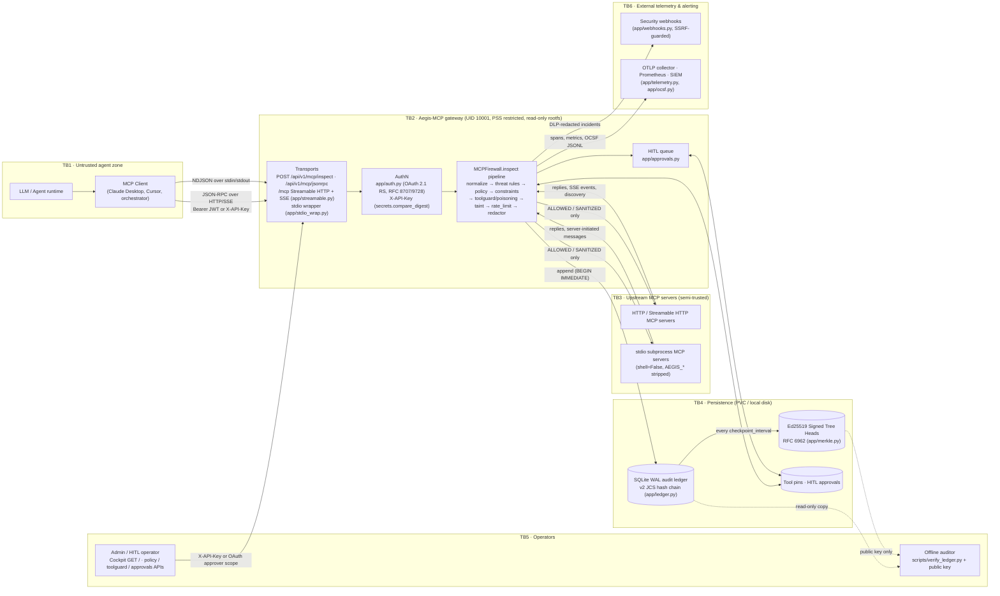

# Aegis-MCP v0.2.0 — STRIDE Threat Model & Regulatory Control Matrix

| Field | Value |
| :--- | :--- |
| System | Aegis-MCP gateway `0.2.0` (`pyproject.toml`, `deploy/helm/aegis-mcp/Chart.yaml`) |
| Method | STRIDE per trust boundary, then a control matrix against external frameworks |
| Last reviewed | 2026-11-27 |
| Review trigger | Any new transport, trust boundary, persistence backend, or authentication mode; otherwise every minor release |
| Related | [`SECURITY.md`](/SECURITY.md), [`BACKLOG.md`](/BACKLOG.md), [`README.md`](/README.md) |

This document covers the gateway itself: the code in `app/`, its HTTP, Streamable HTTP and `stdio` transports, its SQLite audit ledger, and its operator and telemetry interfaces. Aegis-MCP is a *control* that an MCP deployment uses. It does not by itself make an AI system safe or compliant. The [control matrix](#6-regulatory--framework-control-matrix) shows which obligations it provides evidence for and which stay with the operator.

---

## 1. Scope & Security Objectives

**Assets**

| ID | Asset | Why it matters |
| :--- | :--- | :--- |
| A1 | Upstream MCP tool capabilities (filesystem, SQL, HTTP, email, git) | An agent that controls them can delete, leak or exfiltrate data. |
| A2 | Data that flows through tool arguments and replies (PII, secrets, business data) | Confidentiality, and the GDPR / EU AI Act data-governance duties that apply to it. |
| A3 | The audit ledger (`AuditLedger` hash chain + Ed25519 Signed Tree Heads) | Evidence for incident response, EU AI Act Art. 12 and ISO/IEC 42001 A.6.2.8. |
| A4 | The security policy (RBAC/ABAC YAML, `tool_constraints`, `taint_rules`, `rate_limits`) | Whoever changes it changes what agents may do. |
| A5 | Credentials: `AEGIS_API_KEY`, OAuth JWKS trust, `AEGIS_DLP_HMAC_KEY`, Ed25519 signing key | If one leaks, the attacker can impersonate an operator, forge checkpoints, or correlate pseudonyms. |
| A6 | Tool pins and HITL approvals (SQLite) | They decide which tools may run and which risky calls a human allowed. |
| A7 | Gateway availability | The gateway is fail-closed, so an outage stops all agent tool use. |

**Security objectives**

1. No `tools/call`, `resources/read` or `prompts/get` reaches an upstream server without passing `MCPFirewall.inspect` (threat rules, RBAC/ABAC, toolguard, taint, rate limits, DLP).
2. Raw secrets and PII never leave the gateway in a forwarded argument, a ledger row, a log line, a span or a webhook.
3. Every decision is recorded, and tampering with any recorded decision can be detected offline with only the public key.
4. Identity, policy and approvals are bound to authenticated principals. The gateway fails closed when it cannot tell who the caller is or which policy applies.

**Out of scope:** the LLM and its alignment, the internal security of upstream MCP servers, the MCP host application (Claude Desktop, Cursor, Windsurf), the OAuth authorization server, and Kubernetes control-plane hardening beyond what the Helm chart ships.

---

## 2. Architecture & Trust Boundaries

| Boundary | Crosses | Main entry points | Trust assumption |
| :--- | :--- | :--- | :--- |
| **TB1 → TB2** | MCP client → gateway | `POST /api/v1/mcp/inspect`, `POST /api/v1/mcp/jsonrpc`, `POST/GET/DELETE /mcp`, `app.stdio_wrap` stdin | The agent may be under the control of an indirect prompt injection. Every argument is hostile. |
| **TB2 → TB3** | Gateway → upstream servers | `JsonRpcGateway` forwarding, `StreamableHttpTransport`, `StdioProxy` subprocess | Upstreams are operator-chosen but may be compromised, rug-pulled, or return attacker-controlled content. |
| **TB3 → TB2** | Upstream replies → gateway → client | discovery (`initialize`, `*/list`), tool results, SSE events, server-initiated messages | Replies are untrusted content (they carry the injection payloads behind the "lethal trifecta"). |
| **TB2 ↔ TB4** | Gateway ↔ SQLite ledger, pins, approvals | `AuditLedger.append`, `ToolGuard`, `ApprovalQueue` | Disk is private to the pod (PVC, `UID 10001`). Someone with node or volume access can still edit files, so integrity must be *detectable*, not assumed. |
| **TB5 → TB2** | Operator → gateway admin plane | `POST /api/v1/policies`, `POST /api/v1/toolguard/approve`, `POST /api/v1/approvals/{id}`, `POST /api/v1/audit/checkpoints`, cockpit `GET /` | Operators are trusted *after* authentication; their actions must themselves be accountable. |
| **TB4 → TB5** | Ledger → offline auditor | `scripts/verify_ledger.py --db … --pubkey …` | The auditor trusts only the Ed25519 public key, not the running service. |
| **TB2 → TB6** | Gateway → webhooks, OTLP, Prometheus, SIEM | `WebhookDispatcher`, OTLP/HTTP exporter, `GET /metrics`, `GET /api/v1/audit/export/ocsf` | Receivers are outside the trust zone: they get redacted data only, and outbound calls must not become an SSRF primitive. |

---

## 3. Control Inventory (Implemented Modules)

| Control | Module | What it enforces |
| :--- | :--- | :--- |
| C-AUTH | [`app/auth.py`](/app/auth.py) | OAuth 2.1 resource server: JWT `iss`/`aud`/`exp`/`nbf` validation against a cached JWKS (rate-limited forced refresh on unknown `kid`). Only an allow-list of asymmetric algorithms is accepted (`none` and `HS*` are rejected, and `kty`/`crv` must match `alg`). RFC 8707 audience binding and RFC 9728 Protected Resource Metadata. `agent_id` is derived only from validated claims (`sub` → `azp` → `client_id`). Client credentials are stripped before forwarding upstream. |
| C-RBAC | [`app/policy.py`](/app/policy.py) | Declarative per-agent / server / environment RBAC (`allow`, `deny`, `require_approval`). `policy_version` = SHA-256 of the RFC 8785 canonical document. In `prod`, a missing or invalid policy **fails closed** (`policy_fail_closed`). `monitor` shadow mode records `would_block`. |
| C-ABAC | [`app/constraints.py`](/app/constraints.py) | Argument-level `tool_constraints`: realpath-canonicalized `path_allow`, `sql_mode: read_only`, `egress_allow` domain lists, `max_bytes`, `max_items`. Any violation blocks with risk `100`. |
| C-PIN | [`app/toolguard.py`](/app/toolguard.py) | TOFU pinning of `initialize` / `tools` / `resources` / `prompts` definitions by JCS SHA-256 fingerprint. Drift (rug-pull) is sticky: the definition is hidden and calls get `tool_definition_drift`. Optional `AEGIS_TOOLGUARD_REQUIRE_APPROVAL`. |
| C-POISON | [`app/poisoning.py`](/app/poisoning.py) | Scans definitions and server `instructions` for hidden instructions, invisible Unicode, context-siphoning parameters and cross-server shadowing. Findings at or above the block threshold hide the definition and block calls with `tool_poisoning`. Also available as a CLI: `scripts/scan_mcp_server.py`. |
| C-NORM | [`app/normalize.py`](/app/normalize.py) | Anti-evasion detection views: NFKC, zero-width/bidi stripping (CVE-2021-42574), tag-character reveal, homoglyph folding, percent/HTML decoding, and bounded recursive Base64/hex decoding. A match visible only after decoding adds `obfuscated_payload`. |
| C-RULES | `app/firewall.py` | Deterministic threat rules: `prompt_injection`, `path_traversal`, `destructive_sql`, `command_injection`. They run on every detection view. |
| C-DLP | [`app/redactor.py`](/app/redactor.py) | Checksum-validated DLP (Luhn, ISO 7064 mod-97 IBAN, DNI/NIE, JWT shape, entropy-gated secrets, sensitive keys). Optional HMAC-SHA256 referential placeholders (`AEGIS_DLP_HMAC_KEY`). Applied to arguments, replies, SSE events, logs, spans and webhooks. |
| C-TAINT | [`app/taint.py`](/app/taint.py) | Per-session "lethal trifecta" tracking (`untrusted_content` + `private_data` → `egress_sink`) that denies with `toxic_flow_exfiltration`. A DLP hit promotes the session to `private_data`. |
| C-RATE | [`app/rate_limit.py`](/app/rate_limit.py) | Token bucket per `(agent, server, tool)` (`rate_limit_exceeded`) and a sliding-window exfiltration velocity detector per `(session, agent)` (`exfiltration_velocity_anomaly`). Memory is LRU-bounded. |
| C-HITL | [`app/approvals.py`](/app/approvals.py) | `require_approval` calls are bound to `(agent, server, tool, environment, JCS SHA-256 of arguments)`. Approvals are single-use and TTL-bound. Pending, denied and expired requests fail closed. Operations are serialized with `BEGIN IMMEDIATE`. |
| C-LEDGER | [`app/ledger.py`](/app/ledger.py) | v2 hash chain: SHA-256 over the JCS canonical *full* entry (identity, decision, violations, DLP categories, sanitized-args digest, policy version/mode, `would_block`, session). Migration from v1 is additive; v1-after-v2 downgrades are rejected. Runs in WAL mode with a single writer under `BEGIN IMMEDIATE`. |
| C-MERKLE | [`app/merkle.py`](/app/merkle.py) | RFC 6962 Merkle tree with domain separation, O(log n) inclusion proofs, and chained Ed25519 Signed Tree Heads (`prev_checkpoint_hash`). Verifiable offline with the public key only. |
| C-OCSF | [`app/ocsf.py`](/app/ocsf.py) | OCSF 1.3.0 API Activity (`class_uid 6003`) JSON Lines export. Each event carries its hash-chain link, Merkle leaf index and covering STH, plus EU AI Act Art. 12 / ISO 42001 A.6.2.8 compliance tags. |
| C-STDIO | [`app/stdio_wrap.py`](/app/stdio_wrap.py) | `stdio` firewall for local MCP servers: full `inspect` pipeline on inbound calls, toolguard/DLP on outbound replies, line caps (1 MiB host / 5 MiB server), `shell=False`, `AEGIS_*` stripped from the child environment, reserved error codes rewritten, unsolicited responses dropped. |
| C-STREAM | [`app/streamable.py`](/app/streamable.py) | MCP Streamable HTTP: `Origin` allow-list (DNS rebinding), gateway-minted `Mcp-Session-Id` bound to caller + server + environment (the upstream id is never exposed), `MCP-Protocol-Version` checks, per-event SSE DLP, bounded session TTL/capacity, wall-clock stream cap. |
| C-HOOK | `app/webhooks.py` | SSRF-hardened webhooks: `https` only, no userinfo, no metadata endpoints, public-address resolution in `prod` (re-checked before each delivery), no redirects. Payloads are re-redacted. High-severity incidents are throttled. Delivery is fire-and-forget on a bounded pool. |
| C-OBS | `app/telemetry.py`, `app/metrics.py` | OTLP spans with a pseudonymized `aegis.session.id`, DLP-scrubbed JSON logs, label-sanitized Prometheus metrics capped at 64 values per label. |
| C-PLATFORM | `Dockerfile`, `deploy/helm/aegis-mcp`, `policy/*.rego`, `.github/workflows/release.yml` | Non-root `UID 10001`, PSS restricted, read-only rootfs, default-deny NetworkPolicy, single-replica `StatefulSet` guard. Releases ship cosign keyless signatures, a CycloneDX SBOM attestation and SLSA L3 provenance. |

---

## 4. STRIDE Analysis per Trust Boundary

Risk ratings are *residual* (after the listed mitigations), on a Likelihood × Impact scale: **H** / **M** / **L**.

### 4.1 TB1 → TB2 — MCP Client ↔ Gateway (HTTP, Streamable HTTP/SSE, `stdio`)

| STRIDE | Threat | Mitigations (module) | Residual |
| :--- | :--- | :--- | :--- |
| **S** | Agent impersonates another agent to inherit its RBAC grants. | `oauth` mode: `agent_id` is taken only from validated JWT claims, audience-bound per RFC 8707 (`app/auth.py`). `api_key` mode compares keys in constant time. | **M** in `api_key` mode, where `X-Aegis-Agent-Id` is asserted by the caller and only the shared key is verified. Use `AEGIS_AUTH_MODE=oauth` for multi-tenant deployments. |
| **S** | JWT algorithm confusion (`alg: none`, `HS256` signed with the RSA public key) or replay of a token minted for another resource. | Asymmetric allow-list enforced at configuration time and again at validation; `kty`/`crv` ↔ `alg` match; `aud` must contain the canonical resource (`app/auth.py`). | **L** |
| **S** | A malicious web page drives a local gateway through the browser (DNS rebinding) or hijacks another caller's `Mcp-Session-Id`. | `Origin` allow-list, and sessions bound to caller + server + environment, so foreign sessions get `404` (`app/streamable.py`). | **L** |
| **T** | Indirect prompt injection or obfuscated payloads in arguments (Base64, full-width, zero-width, homoglyphs, tag characters). | `app/normalize.py` detection views + `app/firewall.py` rules; `obfuscated_payload` violation. | **M**: there are documented gaps (newline-split phrases, `0x` hex, backticks, comment-split SQL; see README *Known detection gaps*). |
| **T** | Argument tampering to escape scope (dot-dot segments, symlinks, write SQL, egress to attacker hosts, oversized payloads). | `app/constraints.py` (realpath `path_allow`, `sql_mode: read_only`, `egress_allow`, `max_bytes`/`max_items`); `app/firewall.py` path/command/SQL rules. | **L** where `tool_constraints` are declared. **M** where they are not (pattern rules only). |
| **T** | A parser differential smuggles a second message (JSON-RPC batch, duplicate ids, oversized NDJSON line). | Batches only for sessions that negotiated `2025-03-26`; strict envelope parsing (`app/jsonrpc.py`); `stdio` line caps and client batches rejected with `-32600` (`app/stdio_wrap.py`). | **L** |
| **R** | Agent denies having issued a call, or a call is executed without a record. | Every decision (including `monitor` `would_block`) is appended to the v2 ledger with identity, session, policy version and args digest **before** forwarding (`app/ledger.py`). | **L** |
| **I** | Secrets or PII in arguments reach the upstream server, an LLM, logs or traces. | `app/redactor.py` on arguments, with HMAC pseudonymous placeholders; scrubbed logs and spans (`app/telemetry.py`). | **M**: pattern-based DLP cannot recognize free-text confidential business data. |
| **I** | Error messages or reserved JSON-RPC codes leak internal state. | Fixed error bodies (`-32003` carries only `violations` + `audit_hash`). Upstream `-32003`/`-32004` are rewritten to `-32000` (`app/stdio_wrap.py`, `app/streamable.py`). | **L** |
| **D** | Request floods, data-harvesting bursts, unbounded SSE streams or session tables. | `app/rate_limit.py` token bucket + velocity window (LRU-capped); `AEGIS_MCP_MAX_SESSIONS` (`503`), session TTL, `AEGIS_MCP_STREAM_TIMEOUT_SECONDS` (`app/streamable.py`); `stdio` line caps. | **M**: no network-level rate limiting in front of authentication; put an ingress or WAF in front. |
| **E** | Agent invokes tools beyond its role (excessive agency) or completes a multi-step exfiltration chain. | Default-deny RBAC and fail-closed `prod` (`app/policy.py`); `require_approval` HITL (`app/approvals.py`); toxic-flow taint (`app/taint.py`); RBAC-filtered `tools/list`. | **M**: sessionless calls are evaluated statelessly, so an agent that never sends a session id avoids cross-call taint (velocity still applies per agent). |

### 4.2 TB2 ↔ TB3 — Gateway ↔ Upstream MCP Servers

| STRIDE | Threat | Mitigations (module) | Residual |
| :--- | :--- | :--- | :--- |
| **S** | Upstream server shadows another server's tool name to intercept calls (cross-server shadowing). | Cross-server name collision + shadowing instructions detection (`app/poisoning.py`, `scan_servers`). | **M**: a bare name collision alone scores 60, below the block threshold. |
| **T** | Rug-pull: the server changes a tool's description or schema after approval. | Sticky drift detection by JCS fingerprint; the drifted definition is hidden and calls are blocked until re-approved (`app/toolguard.py`). | **L** |
| **T** | Tool poisoning: hidden instructions in descriptions, schema defaults or `instructions`; invisible Unicode. | `app/poisoning.py` + `app/normalize.py`; poisoned `instructions` are stripped. | **M**: semantic poisoning phrased as benign documentation can evade the pattern scoring. |
| **T** | Malicious tool *results* (indirect prompt injection returned to the agent). | Replies are DLP-redacted and toolguard-screened; untrusted-content roles taint the session so a later egress is denied (`app/taint.py`). | **M**: Aegis does not rewrite natural-language results; the LLM can still be steered *within* its allowed tools. |
| **R** | Upstream denies having returned a given definition. | Pins record fingerprint, first-seen and drift fingerprint (`app/toolguard.py`); decisions are in the ledger. | **L** |
| **I** | Upstream reply leaks secrets or PII to the agent or the LLM provider. | Outbound DLP on replies and every SSE event (`app/streamable.py`, `app/stdio_wrap.py`); a redaction promotes the session to `private_data`. | **M**: same DLP coverage limits as 4.1. |
| **I** | Gateway credentials leak to the upstream (`Authorization`, `X-API-Key`, `AEGIS_*` env). | `strip_credentials` before forwarding (`app/auth.py`); the upstream session id is never exposed; `child_environment` strips every `AEGIS_*` variable (`app/stdio_wrap.py`). | **L** |
| **D** | Slow-loris SSE, endless streams, or a hung `stdio` child blocks the gateway. | Stream wall-clock deadline and upstream read timeout (`app/streamable.py`); `stdio` relay threads with bounded reads. | **M** |
| **E** | `stdio` server escapes via shell metacharacters in its command line. | `spawn` uses `shell=False` with an argv list (`app/stdio_wrap.py`). | **L**: the child still runs with the host user's privileges, so sandbox it at OS level. |

### 4.3 TB2 ↔ TB4 — SQLite WAL Audit Ledger, Ed25519 Checkpoints, Pins & Approvals

| STRIDE | Threat | Mitigations (module) | Residual |
| :--- | :--- | :--- | :--- |
| **S** | Attacker forges a Signed Tree Head. | Ed25519 signatures over the JCS canonical tree head; verifiers pin the public key and its fingerprint (`app/merkle.py`, `scripts/verify_ledger.py --pubkey`). | **L** while the private key stays in a Kubernetes Secret or KMS. |
| **T** | Edit a recorded decision, violations, DLP categories or policy version. | v2 full-payload JCS hash chain; `GET /api/v1/audit/verify`; offline `scripts/verify_ledger.py` (`app/ledger.py`). | **L** |
| **T** | Downgrade to weaker v1 links, re-hash history, reorder or delete entries. | v1-after-v2 rejected; history is never re-hashed; RFC 6962 roots and chained STHs (`prev_checkpoint_hash`) detect reordering and deletion before the last checkpoint (`app/merkle.py`). | **M**: entries **after** the latest STH can be truncated without detection until the next checkpoint. Keep `checkpoint_interval` small and export STHs/OCSF off-host. |
| **T** | Full rewrite by an attacker who holds both disk access **and** the signing key. | Out-of-band copies: OCSF export carries entry hashes and covering STHs to the SIEM (`app/ocsf.py`). | **M**: there is no external transparency-log anchoring yet. |
| **T** | Concurrent writers fork the chain. | `BEGIN IMMEDIATE` before reading the head; single-replica `StatefulSet` guard in the Helm chart. | **L** |
| **R** | An operator disputes having approved a tool or HITL request. | HITL approvals record `resolved_by` (`api-key-admin` or the OAuth principal) and are single-use (`app/approvals.py`); toolguard pins record `status` and `updated_at`. | **M**: in `api_key` mode all operators share one identity, and pins do not store *who* approved them. |
| **I** | The ledger discloses the secrets it audits. | Only `args_digest` (JCS SHA-256 of *sanitized* arguments) and category names are stored, never raw arguments (`app/ledger.py`). | **L** |
| **D** | Disk exhaustion or SQLite lock contention stalls decisions. | WAL mode; `aegis_mcp_ledger_errors_total` metric and alerts. A ledger failure is surfaced, never silently skipped. | **M**: no built-in retention or rotation yet (operators must size the PVC). |
| **E** | Replay of an approval for different arguments or a different agent. | `ApprovalKey` binds agent, server, tool, environment and argument hash; single-use with a TTL (`app/approvals.py`). | **L** |

### 4.4 TB5 → TB2 — Admin / HITL Operator Plane (Cockpit, Policy, Toolguard, Approvals)

| STRIDE | Threat | Mitigations (module) | Residual |
| :--- | :--- | :--- | :--- |
| **S** | Agent self-approves its own HITL request or pins its own tool. | Admin endpoints require the admin `X-API-Key` (fail-closed when unset) or, in `oauth` mode, `AEGIS_HITL_APPROVER_SCOPE` (`require_approver` in `app/main.py`, `app/auth.py`). | **M** if the agent and the operator share one API key. Use separate credentials. |
| **T** | Malicious policy upload widens permissions. | Admin-only `POST /api/v1/policies`; schema validation (`app/policy.py`); `policy_version` hash in every ledger entry makes the change auditable. | **M**: there is no dual control (four-eyes) on policy changes. |
| **T** | XSS or clickjacking in the cockpit leads to approval forgery. | Strict CSP (`script-src 'self'`, no inline script, `frame-ancestors 'none'`); the operator key lives only in `sessionStorage`. | **L** |
| **R** | Operator actions are not attributable. | HITL `resolved_by` is stored with each resolution; `policy_version` binds every decision to a policy revision. | **M** in `api_key` mode (shared identity). |
| **I** | Cockpit or audit APIs expose sensitive arguments. | They serve redacted fields and digests only. | **L** |
| **D** | Approval fatigue: the human is flooded with requests (OWASP Agentic T10). | TTL expiry fails closed; high-severity webhooks are throttled per key (`app/webhooks.py`); rate limits cut bursts before they reach HITL. | **M**: there is no per-agent cap on pending approvals. |
| **E** | Stolen admin key gives full control of policy and approvals. | Constant-time comparison; key comes from a Secret, never logged; `oauth` mode with scoped tokens. | **M** |

### 4.5 TB2 → TB6 — Webhooks, OTLP, Prometheus, SIEM

| STRIDE | Threat | Mitigations (module) | Residual |
| :--- | :--- | :--- | :--- |
| **S** | A spoofed receiver collects incidents. | `https` required; in `prod` the destination must resolve to public addresses. | **M**: webhook payloads are not signed (no HMAC signature header yet). |
| **T** | SIEM events altered after export. | Each OCSF event carries its `entry_hash`, `prev_hash`, Merkle leaf index and covering STH, so the SIEM can re-verify (`app/ocsf.py`). | **L** |
| **I** | PII or secrets leak through logs, spans, metric labels or webhook bodies. | DLP on logs, spans and webhooks; pseudonymized `aegis.session.id`; no `agent_id`/`session_id` metric labels; label cardinality cap. | **L** |
| **D** | A dead or slow receiver delays firewall decisions. | Fire-and-forget bounded thread pool with hard timeouts; failures are logged, never raised (`app/webhooks.py`). | **L** |
| **E** | SSRF via webhook URL (cloud metadata, internal services, DNS rebinding, redirects). | Userinfo and metadata hosts refused; public-IP check at startup and before each delivery; redirects never followed; default-deny egress NetworkPolicy. | **L** |

### 4.6 Supply Chain & Platform (cross-cutting)

| STRIDE | Threat | Mitigations | Residual |
| :--- | :--- | :--- | :--- |
| **S/T** | Tampered container image or Helm chart. | Cosign keyless signatures, CycloneDX SBOM attestation, SLSA L3 provenance, post-publish verification (`.github/workflows/release.yml`). | **L** if consumers verify (see [`SECURITY.md`](/SECURITY.md#4-verifying-releases-cosign--slsa)). |
| **T** | Vulnerable Python dependency. | `uv.lock` frozen sync, `pip-audit`, `bandit`, CodeQL. | **M**: it depends on how quickly upstream advisories appear. |
| **E** | Container breakout or privilege escalation. | Non-root `UID 10001`, read-only rootfs, PSS restricted, no SA token, OPA/Rego gates (`policy/*.rego`). | **L** |

---

## 5. Residual Risk Register

| ID | Residual risk | Rating | Treatment / Owner |
| :--- | :--- | :--- | :--- |
| R1 | Pattern-based detection has documented false negatives (README *Known detection gaps*, recall 0.9536 on the committed corpus). | M | Accept and monitor; defense in depth through `tool_constraints`, RBAC and taint. Detection-gap work tracked in `BACKLOG.md`. |
| R2 | `api_key` mode trusts the caller-asserted `X-Aegis-Agent-Id` and gives all operators one shared identity; toolguard pins do not record the approving operator. | M | Mitigate: use `AEGIS_AUTH_MODE=oauth` in multi-tenant or `prod` deployments. |
| R3 | Truncation of entries after the latest STH, or a full rewrite by an attacker who also holds the signing key. | M | Mitigate: small `checkpoint_interval`, signing key in KMS or a sealed Secret, continuous OCSF/STH export off-host. Planned: external transparency-log anchoring. |
| R4 | Sessionless calls bypass cross-call toxic-flow taint. | M | Mitigate: require `Mcp-Session-Id` (Streamable HTTP) or `stdio` (always session-bound); velocity still applies per agent. |
| R5 | Semantic tool poisoning and natural-language result steering within allowed tools. | M | Accept; combine with least-privilege RBAC and `require_approval` for sinks. |
| R6 | No dual control on policy updates; no per-agent cap on pending approvals. | M | Mitigate operationally: GitOps-managed policy files and review. Candidate backlog item. |
| R7 | Webhook payloads are unsigned. | M | Mitigate: mTLS or an authenticated receiver URL. Candidate backlog item. |
| R8 | SQLite ledger is single-writer and single-replica (no HA) and has no retention policy. | M | Accept for `0.2.x`; tracked as `[persistence/postgres-ledger]` in `BACKLOG.md`. |
| R9 | `monitor` (shadow) mode records but does not block. | L | Accept: by design for rollouts. Alert on `aegis_mcp_shadow_would_block_total`, and never run `prod` in `monitor` without an explicit risk acceptance. |

---

## 6. Regulatory & Framework Control Matrix

**Legend:** **●** control directly mitigates or evidences the item · **◐** partial / supporting control · **○** out of scope for a gateway (operator or model responsibility).

### 6.1 OWASP Top 10 for LLM Applications 2025

| ID | Risk | Aegis-MCP controls | Coverage |
| :--- | :--- | :--- | :---: |
| LLM01:2025 | Prompt Injection | C-RULES + C-NORM (direct and obfuscated injection in arguments), C-POISON (injection in definitions), C-TAINT (indirect injection → exfiltration chain), C-HITL | ● |
| LLM02:2025 | Sensitive Information Disclosure | C-DLP on arguments, replies, SSE, logs, spans and webhooks; C-ABAC `egress_allow`; C-TAINT; `args_digest` instead of raw arguments in C-LEDGER | ● |
| LLM03:2025 | Supply Chain | C-PIN (rug-pull), C-POISON + `scripts/scan_mcp_server.py`, C-PLATFORM (cosign, SBOM, SLSA L3, `pip-audit`) | ● |
| LLM04:2025 | Data and Model Poisoning | C-POISON covers *tool-context* poisoning only; training and fine-tuning data are out of scope | ◐ |
| LLM05:2025 | Improper Output Handling | C-RULES on downstream sinks (SQL, shell, path), C-ABAC `sql_mode: read_only` / `path_allow`, reply DLP and toolguard screening | ● |
| LLM06:2025 | Excessive Agency | C-RBAC default-deny + fail-closed `prod`, C-ABAC, least-privilege `tools/list`, C-HITL `require_approval`, C-TAINT | ● |
| LLM07:2025 | System Prompt Leakage | C-DLP strips secrets that may be embedded in prompts or arguments; C-RULES blocks instruction-override and role-marker injection; prompt confidentiality itself stays with the host | ◐ |
| LLM08:2025 | Vector and Embedding Weaknesses | Only when the vector store is exposed as an MCP tool: C-RBAC, C-ABAC, C-RATE velocity on `query*` reads | ◐ |
| LLM09:2025 | Misinformation | Model output quality is out of scope | ○ |
| LLM10:2025 | Unbounded Consumption | C-RATE token bucket + velocity, C-ABAC `max_bytes`/`max_items`, C-STREAM session cap and stream timeout, `stdio` line caps | ● |

### 6.2 OWASP Agentic AI — Threats & Mitigations (T1–T15)

| ID | Threat | Aegis-MCP controls | Coverage |
| :--- | :--- | :--- | :---: |
| T1 | Memory Poisoning | C-TAINT session labels, C-POISON on definitions and `instructions`, reply DLP. Agent long-term memory stores are out of scope. | ◐ |
| T2 | Tool Misuse | C-RBAC, C-ABAC, C-RULES, C-PIN, C-TAINT, C-HITL | ● |
| T3 | Privilege Compromise | C-AUTH (claim-derived identity, audience binding), C-RBAC per agent / environment, credential stripping upstream | ● |
| T4 | Resource Overload | C-RATE, C-STREAM limits, `max_bytes`/`max_items` | ● |
| T5 | Cascading Hallucination Attacks | Output verification is out of scope; C-HITL can gate high-impact actions | ○ |
| T6 | Intent Breaking & Goal Manipulation | C-RULES + C-NORM prompt-injection detection, C-TAINT, C-POISON | ● |
| T7 | Misaligned & Deceptive Behaviors | C-RBAC / C-HITL bound what a misaligned agent can *do*; detecting the behavior itself is out of scope | ◐ |
| T8 | Repudiation & Untraceability | C-LEDGER v2, C-MERKLE STHs, C-OCSF, `scripts/verify_ledger.py` | ● |
| T9 | Identity Spoofing & Impersonation | C-AUTH (OAuth 2.1, RFC 8707/9728, algorithm-confusion defense), C-STREAM session binding and `Origin` checks | ● (`oauth`) / ◐ (`api_key`) |
| T10 | Overwhelming Human in the Loop | C-HITL TTL fail-closed, argument-bound single-use approvals, webhook throttling, C-RATE | ◐ |
| T11 | Unexpected RCE and Code Attacks | C-RULES `command_injection`, C-ABAC, C-STDIO `shell=False`, C-PLATFORM sandboxing | ● |
| T12 | Agent Communication Poisoning | C-DLP + C-POISON on every MCP message; JSON-RPC envelope validation; agent-to-agent protocols other than MCP are out of scope | ◐ |
| T13 | Rogue Agents in Multi-Agent Systems | Per-agent RBAC, C-RATE velocity, C-LEDGER attribution, webhook incidents | ◐ |
| T14 | Human Attacks on Multi-Agent Systems | C-AUTH, per-agent policy isolation, approver scope separation | ◐ |
| T15 | Human Manipulation | Out of scope (agent ↔ end-user conversation) | ○ |

> The detection corpus (`benchmarks/corpus/*.jsonl`, field `owasp_agentic`) uses the newer `ASI0x` identifiers from the OWASP Top 10 for Agentic Applications. Rough correspondence: ASI01 ≈ T6, ASI02 ≈ T2, ASI03 ≈ T3/T9, ASI04 ≈ supply chain (LLM03), and memory/context poisoning ≈ T1.

### 6.3 MITRE ATLAS

| Technique | Name | Aegis-MCP controls | Coverage |
| :--- | :--- | :--- | :---: |
| AML.T0051 (.000 / .001) | LLM Prompt Injection (direct / indirect) | C-RULES, C-NORM, C-POISON, C-TAINT | ● |
| AML.T0054 | LLM Jailbreak | C-RULES instruction-override markers in tool arguments; jailbreaks of the model itself are out of scope | ◐ |
| AML.T0053 | LLM Plugin Compromise (agent tool invocation) | C-RBAC, C-ABAC, C-PIN, C-HITL | ● |
| AML.T0010 | ML Supply Chain Compromise | C-PIN, C-POISON, C-PLATFORM signed releases | ● |
| AML.T0057 | LLM Data Leakage | C-DLP, C-TAINT, C-ABAC `egress_allow` | ● |
| AML.T0024 | Exfiltration via ML Inference API | C-RATE velocity detector, C-TAINT egress denial | ◐ |
| AML.T0048 | External Harms | C-HITL + C-RBAC limit financial, reputational and user harm from tool actions | ◐ |
| AML.T0029 | Denial of ML Service | C-RATE, C-STREAM caps | ◐ |
| AML.T0034 | Cost Harvesting | C-RATE token bucket per agent / tool | ◐ |
| AML.T0055 | Unsecured Credentials | C-DLP secret detection, `AEGIS_*` stripping, `strip_credentials` | ● |
| AML.T0012 | Valid Accounts | C-AUTH short-lived audience-bound tokens, per-agent RBAC, ledger attribution | ◐ |

> Technique IDs and names follow the ATLAS matrix at the time of writing. Check them against <https://atlas.mitre.org> on each review.

### 6.4 NIST AI Risk Management Framework (AI RMF 1.0, incl. AI 600-1 GenAI Profile)

| Function / Subcategory | Expectation | Aegis-MCP evidence | Coverage |
| :--- | :--- | :--- | :---: |
| GOVERN 1.4 | Risk management is transparent and documented | This threat model, `SECURITY.md`, `policy_version`-bound decisions | ● |
| GOVERN 1.5 | Ongoing monitoring and periodic review are planned | Review triggers (header), Grafana / `PrometheusRule` alerts, detection-benchmark CI gate | ● |
| GOVERN 6.1 | Policies address third-party AI risks | C-PIN, C-POISON, signed releases, `pip-audit` | ● |
| MAP 4.1 | Risks of third-party components are mapped | §4.2 upstream analysis, `scripts/scan_mcp_server.py` | ● |
| MEASURE 2.4 | Functionality and behavior are monitored in production | OTLP spans, SLO histogram, `aegis_mcp_*` metrics, OCSF export | ● |
| MEASURE 2.7 | Security and resilience are evaluated | Detection benchmark (recall / FPR gate), fuzzing (`fuzz/`), SAST, latency p99 gate | ● |
| MEASURE 2.8 | Transparency and accountability risks are examined | C-LEDGER / C-MERKLE tamper evidence and approver attribution | ● |
| MEASURE 2.10 | Privacy risk is examined | C-DLP, HMAC pseudonymization, digest-only ledger | ● |
| MANAGE 2.4 | Mechanisms exist to supersede, disengage or deactivate AI systems | Fail-closed `prod` policy, deny rules, HITL `require_approval`, hot policy reload | ● |
| MANAGE 3.1 | Third-party risks are monitored and controls applied | Sticky drift detection, poisoning re-scan on every discovery | ● |
| MANAGE 4.1 | Post-deployment monitoring plans exist | `monitor` shadow mode, `would_block` metrics, alert rules | ● |
| MANAGE 4.3 | Incidents are tracked and communicated | Security webhooks, OCSF SIEM export, `SECURITY.md` disclosure process | ● |

### 6.5 EU AI Act (Regulation (EU) 2024/1689)

Aegis-MCP is deployer-side tooling. It provides **technical evidence** for the obligations below. Whether a system is *high-risk* (Art. 6, Annex III), and therefore bound by them, is a legal determination for the provider or deployer.

| Article | Obligation | Aegis-MCP controls | Coverage |
| :--- | :--- | :--- | :---: |
| Art. 12(1) | Automatic recording of events (logs) over the system's lifetime | Every tool decision is appended to C-LEDGER automatically, including shadow-mode `would_block` | ● |
| Art. 12(2)(a) | Logs enable identifying situations that may present a risk | `violations`, `risk_score`, `decision`, taint and velocity anomalies per entry | ● |
| Art. 12(2)(b) | Logs facilitate post-market monitoring | OCSF 1.3.0 export with `unmapped.compliance` tags (`app/ocsf.py`), metrics and alerts | ● |
| Art. 12(2)(c) | Logs support monitoring of operation by deployers (Art. 26(5)) | Cockpit audit feed, `GET /api/v1/audit/entries`, chain verification | ● |
| Art. 12 (integrity) | Logs must be trustworthy to have evidentiary value | v2 JCS hash chain, RFC 6962 inclusion proofs, Ed25519 STHs, offline `scripts/verify_ledger.py` | ● |
| Art. 19 / Art. 26(6) | Retain automatically generated logs for at least six months | Durable PVC (`Retain`) and SIEM export; **retention policy is the operator's responsibility** | ◐ |
| Art. 14(1) | Human-machine interface tools allow effective oversight | Cockpit (`GET /`), HITL queue, toolguard approval UI | ● |
| Art. 14(4)(a)/(c) | Overseers understand capabilities and correctly interpret outputs | Pinned tool inventory, decision rationale (`violations`, `risk_score`), poisoning findings | ◐ |
| Art. 14(4)(b) | Awareness of automation bias | Approval requests show argument summaries and violations; the bias itself is organizational | ◐ |
| Art. 14(4)(d) | Decide not to use, disregard or override the output | `require_approval` deny, toolguard un-pinning, policy `deny` rules | ● |
| Art. 14(4)(e) | Intervene or interrupt ("stop" capability) | Fail-closed deny-all policy, `DELETE /mcp` session termination, hot policy reload | ● |
| Art. 15(4)–(5) | Robustness and cybersecurity against manipulation (prompt injection, data poisoning) | C-RULES, C-NORM, C-POISON, C-TAINT, C-PIN | ● |

### 6.6 ISO/IEC 42001:2023 (AI Management System) — Annex A

| Control | Title | Aegis-MCP evidence | Coverage |
| :--- | :--- | :--- | :---: |
| A.2.2 | AI policy | Declarative, versioned YAML policy (`policy_version`) | ◐ |
| A.3.2 | AI roles and responsibilities | Separate agent and approver credentials / OAuth scopes; this document's ownership model | ◐ |
| A.5.2 / A.5.4 | AI system impact assessment (individuals, society) | This STRIDE model and residual risk register (§5) as technical input | ◐ |
| A.6.2.4 | AI system verification and validation | Detection benchmark CI gate, fuzzing, ≥ 85 % coverage, mutation hardening | ● |
| A.6.2.6 | AI system operation and monitoring | OTLP, Prometheus SLOs, Grafana dashboard, `PrometheusRule` alerts | ● |
| A.6.2.8 | AI system recording of event logs | C-LEDGER + C-MERKLE + C-OCSF (tagged in every OCSF event) | ● |
| A.7.4 / A.7.5 | Data quality / data provenance | DLP categories and `args_digest` per decision; reply provenance through taint roles | ◐ |
| A.8.4 | Communication of incidents | Security webhooks, SIEM export, `SECURITY.md` disclosure policy | ● |
| A.9.2 / A.9.4 | Responsible use / intended use of AI systems | RBAC per agent and environment, `tool_constraints`, HITL for high-impact actions | ● |
| A.10.2 / A.10.3 | Allocation of responsibilities / suppliers | C-PIN + C-POISON vet MCP suppliers; signed SBOM and SLSA provenance for Aegis-MCP itself | ● |

---

## 7. Maintenance

- Update this document **in the same PR** whenever a new transport, trust boundary, authentication mode, persistence backend or externally reachable endpoint is added.
- Each residual risk that gets fixed moves from §5 to the relevant mitigation table, with a link to the implementing module.
- `tests/test_security_docs.py` checks that every module this document references exists and that `README.md` links here, so renames cannot leave dangling references.
